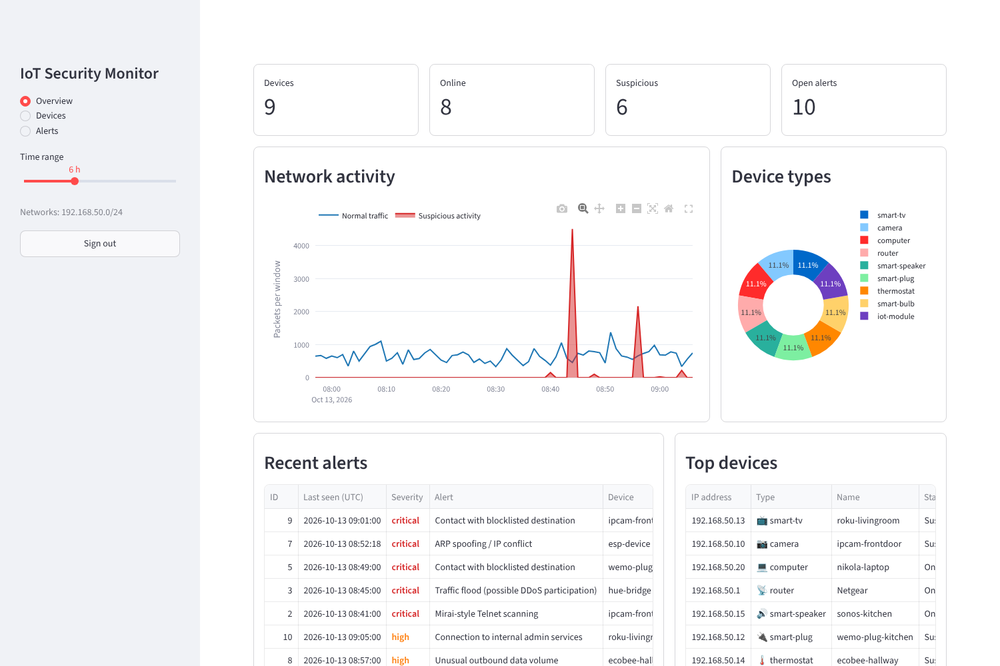
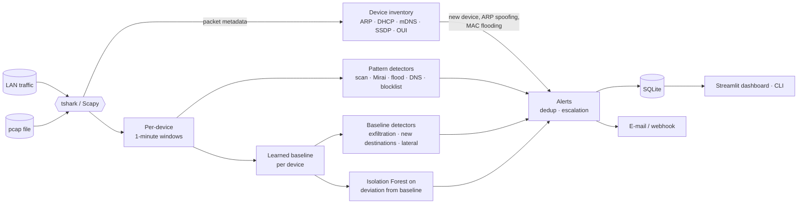

# IoT Security Monitoring Platform


Monitors the IoT devices on a network, learns how each of them normally
behaves and raises alerts when one starts doing something it should not:
scanning the network, joining a botnet, flooding a target, tunnelling data
out over DNS, talking to known command-and-control servers or impersonating
the router.



## Why

Cameras, smart plugs, bulbs and TVs ship with weak defaults, rarely get
updates and cannot run endpoint security. The network is the only place
where their behaviour can be observed. Because each of these devices does
one job, its traffic is very regular, which makes deviations stand out.

## Features

| Workflow step | What it does |
|---------------|--------------|
| **Discover devices** | Passive inventory from ARP, DHCP (host name, vendor class), mDNS services and SSDP banners; optional ARP sweep and TCP-connect probe of IoT ports; vendor lookup by MAC prefix; automatic device-type classification (camera, smart plug, TV, ...). |
| **Capture & monitor** | Live capture or pcap replay with two interchangeable backends: **tshark** (recommended, unprivileged through dumpcap) and **Scapy** (opens the raw socket as root, then drops to an unprivileged user). Only metadata is kept, never payloads. |
| **Analyse behaviour** | Per-device one-minute traffic windows (volumes, peers, ports, DNS, TLS SNI ...). A learned baseline per device and an Isolation Forest that scores how far each window deviates from that device's own normal. |
| **Detect anomalies** | Mirai-style Telnet scanning, port / host scans, traffic floods, DNS tunnelling and DGA, data exfiltration, contact with blocklisted IPs and domains, lateral movement to admin services, cleartext protocols, ARP spoofing, unknown devices, MAC flooding, and ML behaviour anomalies. |
| **Alert & visualise** | Password-protected Streamlit dashboard (KPIs, live traffic, device types, alerts, device inventory with approve / label actions), e-mail alerts over TLS (smtplib), Slack/Teams webhooks, CLI views. |

## How it works



* **Learning period.** For the first `baseline.learning_hours` (24 h by
  default) every device builds its profile and devices already present are
  taken as the trusted inventory. Pattern detectors (scans, floods, Mirai,
  DNS tunnelling, blocklists, ARP spoofing) are active from the first
  packet; baseline and ML detectors start once a device has finished
  learning. Windows that raised an alert never teach the baseline.
* **ML that compares a device with itself.** Raw volumes are meaningless
  across devices - a TV moves more data in a minute than a thermostat in a
  week. Each window is turned into per-feature z-scores against the
  device's own baseline and one Isolation Forest learns what normal
  deviation looks like. A single anomalous minute is reported as *low*;
  a deviation that persists over consecutive windows becomes *medium*.
* **Alerts are deduplicated.** Repeats of the same alert on the same device
  within the cooldown fold into one alert with a counter; a notification
  goes out when an alert is new or escalates.

More in [docs/architecture.md](docs/architecture.md).

## Quick start

```bash
git clone https://github.com/nlevenov/IoTSecMonitoring.git
cd IoTSecMonitoring
python -m venv .venv && source .venv/bin/activate
pip install -e ".[dev]"          # tshark is optional: apt install tshark

iotsec demo
```

`iotsec demo` generates a simulated smart-home capture (camera, bulb, plug,
TV, thermostat, speaker, laptop, router) with eight staged attacks, analyses
it and starts the dashboard on http://127.0.0.1:8501 with a one-time
password printed in the terminal.

### On a real network

The monitor needs to see the traffic: run it on the router / access point,
on a host attached to a mirror (SPAN) port, or on a Linux box acting as the
IoT VLAN's gateway.

```bash
iotsec hash-password                       # create the dashboard password
cp .env.example .env                       # set interface, networks, keys, hash
set -a && source .env && set +a

iotsec discover --probe                    # optional: ARP sweep + port probe
iotsec monitor                             # live capture (tshark backend)
iotsec dashboard                           # http://127.0.0.1:8501
```

Or with Docker (capture and dashboard run as separate containers with
separate privileges):

```bash
cp .env.example .env && $EDITOR .env
docker compose up --build -d
```

## CLI

| Command | Purpose |
|---------|---------|
| `iotsec monitor [--pcap FILE] [-i IFACE] [--backend tshark\|scapy]` | Capture and analyse traffic, live or from a capture file |
| `iotsec discover [--cidr NET] [--probe]` | ARP sweep (and TCP probe) - refuses targets outside `monitored_networks` |
| `iotsec devices [--approve MAC \| --revoke MAC \| --label MAC NAME --type TYPE]` | Inventory and analyst decisions |
| `iotsec alerts [--ack ID ...] [--resolve ID ...] [--false-positive ID ...]` | Alert triage |
| `iotsec status` | Summary of devices and open alerts |
| `iotsec train` | Retrain the anomaly model from stored behaviour |
| `iotsec dashboard [--host --port]` | Start the hardened Streamlit dashboard |
| `iotsec simulate [-o FILE --seed N]` / `iotsec evaluate --pcap FILE` | Labelled lab capture and detection scoring |
| `iotsec hash-password` / `iotsec import-oui oui.csv` | Dashboard password, full IEEE vendor registry |

## Evaluation

The simulator stages eight attacks after a learning period: an unknown
device joining, Mirai-style Telnet scanning, a SYN flood, DNS tunnelling,
ARP spoofing of the gateway, a 3 MB exfiltration, contact with a C2 server
and SMB/RDP lateral movement. Results on captures generated with seeds that
were **not** used while tuning the detectors (`iotsec simulate --seed N`,
`iotsec evaluate`):

| Seed | Attacks detected (exact type) | Actionable alerts (>= medium) | Actionable precision | Window F1 | Low-severity ML notes |
|-----:|:-----------------------------:|:-----------------------------:|:--------------------:|:---------:|:---------------------:|
| 11 | 8 / 8 | 10 | 1.00 | 1.00 | 0 |
| 23 | 8 / 8 | 10 | 1.00 | 1.00 | 1 |
| 42 | 8 / 8 | 10 | 1.00 | 1.00 | 3 |

The remaining low-severity notes come from the ML layer, which in the lab
only gets ~20 minutes of history per device; in a deployment it learns for
24 hours. Synthetic traffic is cleaner than a real network, so treat these
numbers as a functional benchmark, not a promise of field accuracy.

## Security

Everything read off the wire is attacker-controlled, and the dashboard is a
target in its own right. Highlights (full threat model in
[SECURITY.md](SECURITY.md)):

* All packet-derived strings are sanitized once at ingestion (length caps,
  no control or markup characters); the dashboard never renders raw HTML.
* Dashboard: scrypt password, fail-closed when no password is configured,
  brute-force lockout, session expiry, XSRF protection with SameSite=Strict
  cookies, Host allow-list against DNS rebinding, error details hidden.
* Capture privileges: tshark/dumpcap separation, or Scapy opening its socket
  as root and dropping to an unprivileged user before parsing anything.
* The anomaly model is HMAC-signed and verified before it is unpickled.
* Active scans are confined to the configured networks; e-mail is TLS-only
  with certificate verification; notifications are rate limited.
* Bounded memory under MAC flooding and scan floods.
* CI runs ruff, bandit, pip-audit and the full test suite (including live
  capture and privilege dropping) on every push.

## Project layout

```
src/iotsec/
  capture/      tshark and Scapy backends, defensive TLS/HTTP/SSDP parsers
  discovery/    inventory, ARP spoofing / MAC flood detection, OUI, classification, sweeps
  analysis/     traffic windows, baselines, detectors, Isolation Forest
  dashboard/    Streamlit app and login gate
  engine.py     the monitor pipeline
  notify.py     e-mail (smtplib, TLS) and webhook alerts
  simulate.py   labelled smart-home traffic generator
  storage.py    SQLite persistence
config/         settings.yaml (production), lab.yaml (simulator)
deploy/         systemd units and an nginx TLS proxy
feeds/          threat-intelligence blocklists
tests/          pytest suite (125 tests)
```

## Development

```bash
make dev        # editable install with test and audit tools
make test       # pytest (run as root to include live-capture tests)
make lint       # ruff
make security   # bandit + pip-audit
make evaluate   # simulate a fresh capture and score detection
```

## Roadmap

- Encrypted traffic analysis (JA3/JA4 TLS fingerprints per device)
- Import of public IoT datasets (CIC-IoT-2023, N-BaIoT) into the evaluator
- Deep sequence models (LSTM autoencoder) as an alternative anomaly scorer
- Automated response: quarantine VLAN / firewall rule on critical alerts

## License

MIT - see [LICENSE](LICENSE).
